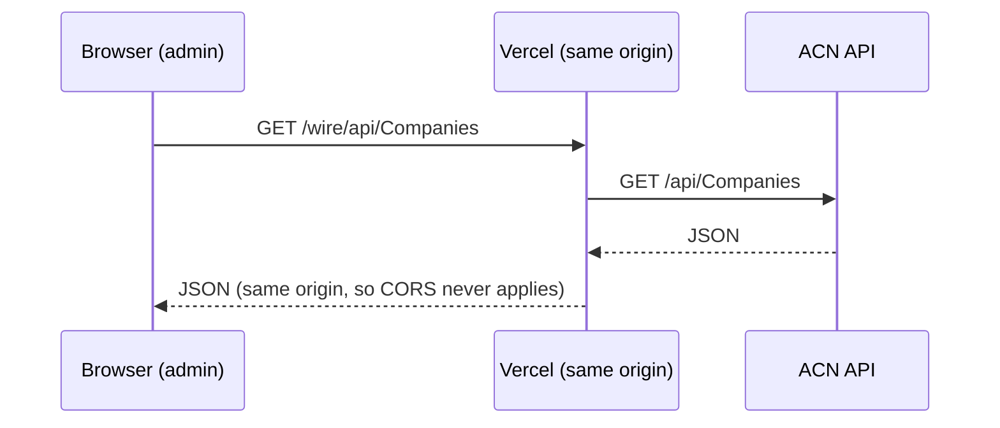
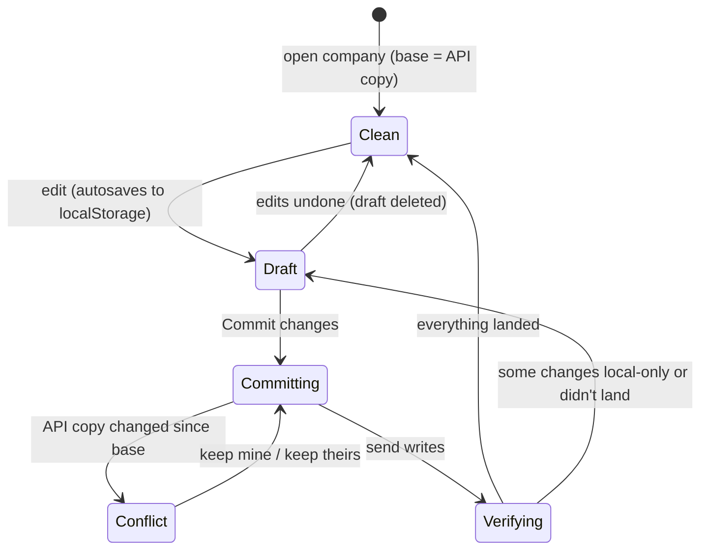

# Admin

Vite 8, React 19, TypeScript 6, React Router 7, TanStack Query, Zustand, TipTap 3 (rich text), Univer (spreadsheet). Plain CSS classes in `src/components/ui/ui.css`; Tailwind is installed but not the idiom. The package is still named `acn-portal`.

::: warning Which version this page describes
This page describes the `feat/api-write-wiring` branch, which has the API save work. `master` is 5 commits behind it. Check which branch Vercel deploys before assuming the live admin behaves like this.
:::

## The /wire proxy

The API's CORS policy is an **allowlist**: a browser call works from one whitelisted localhost port and is blocked from every deployed address. So the browser never calls the API directly. It calls `/wire/*` on its own origin, and the host forwards the request:

- **Development:** `vite.config.ts` proxies `/wire`. Override the target with `WIRE_UPSTREAM`.
- **Production:** `vercel.json` rewrites `/wire/:path*` to the API. That rule **must come before** the SPA catch-all.
- It's called `/wire`, not `/api`, to stay clear of Vercel's functions directory.

`resolveBaseUrl()` in `src/lib/api/client.ts` uses `VITE_API_BASE_URL` if set, else `/wire` in a browser, else the API directly in Node (tests and scripts). **Never set `VITE_API_BASE_URL` to the API's address.** That brings the CORS failure straight back.

Check a deployed proxy with `npm run validate -- --url <admin address>`:
- JSON back means the proxy and the API are fine.
- HTML back means the rewrite is missing or in the wrong order.
- 502, 504 or 522 means the proxy is fine but the API's VM is off.

## The save model (companies)

- localStorage holds two copies per company: `acn_company_{id}` (**base**, the last API version) and `acn_company_draft_{id}` (**draft**).
- One diff engine (`src/lib/companies/diff.ts`) compares base and draft. Each change carries either its API operations or `sync: 'local'` with a reason.
- **Commit** (`src/lib/companies/sync.ts`):
  1. re-fetch `/full`;
  2. detect conflicts;
  3. rebase the edits;
  4. send them (`write.ts` merges basic info and details into one PUT, plus one request per sub-resource);
  5. re-fetch to verify;
  6. keep whatever didn't land as the new draft.
- New companies get local ids from 9,000,001 and are re-keyed after the POST.
- **Events** are local-first too (`acn_event_draft_*`), cleared once the API accepts them. **Press releases** are local only (`acn_article_*`); there is no write endpoint.
- **Caching:**
  - IndexedDB holds API responses. They're disposable, with a 1-hour list TTL and the release total cached for a day.
  - localStorage holds edits, about 5 MB, and is **never disposable**.
  - React Query treats data as stale after 5 minutes.

User-facing messages and what they mean: [how saving works](/guide/admin#the-messages-you-might-see).

## What can be saved

| Resource | Writes wired |
| --- | --- |
| Company core (names, about, details, address, links, legal name, country) | `PUT /api/Companies/{id}`, `POST /api/Companies`, `DELETE` |
| Industries | `PUT/DELETE …/industries/{industryId}` |
| Listings | `POST …/listings`, `PUT/DELETE …/listings/{mic}/{ticker}`. **Blocked on dev until the Exchanges table is seeded.** |
| Social links | `PUT/DELETE …/social-links/{platform}` (Instagram only so far) |
| Events | `POST /api/Events`, `PUT/DELETE /api/Events/{id}` |
| Press releases, sectors, contacts, wire codes, RSS, distribution, status, languages, portal login, files | **No API endpoint.** Local only. |

`docs/seed/` in the repo has an insert-only SQL script for the empty Exchanges (62 MICs) and Countries (266 codes) tables, sent to the API team on 2026-10-19.

## Domain logic worth knowing

- **Press release classification is derived** (`src/lib/press-releases/derive.ts`): the sector comes from the primary issuer's sector type, and the industries from every company's sector name. Override flags exist for both.
- **The dateline lives inside the body**, parsed out and written back (`dateline.ts`), with an override flag.
- **Two taxonomies on the company page.** `lib/sectors.ts` has the 76 ACN entries in 9 groups (ACN's own ids, matched to `/api/Sectors` by name). `lib/industries.ts` has the API's separate 43-entry list. The labels on the company page don't match staff vocabulary yet; see the [glossary](/start/glossary).
- Choosing a sector adds its Reuters and Bloomberg codes (`lib/sector-routing.ts`).
- Every load goes through a `normalize*` function, so old shapes in localStorage keep working.

## Mock API

`npm run mock` starts a zero-dependency stand-in (`mock/server.mjs`), seeded from real trimmed responses. It copies the API's quirks on purpose:
- page size capped at 100;
- the 500 on `/Events/{id}`;
- `""` used for empty values;
- dates without offsets;
- no CORS.

`npm run dev:mock` runs it with Vite, through `/wire`.

## Tests

18 Vitest files, about 380 tests, `npm test`. They cover the API client and mappers, the company diff and sync, events, the sheet commit, and the press release derive/dateline/normalize logic. Seven files use jsdom.

## Known issues

- *Extended About Boilerplate* writes into `about_html`, overwriting the main About text (`tabs/BasicInfoTab.tsx`).
- "+ Add company" on press releases only lists companies in localStorage.
- Distribution tab pick lists are hard-coded mocks; press release pick lists are placeholders (`lib/press-releases/options.ts`).
- `@univerjs/preset-sheets-sort` and `-filter` are imported but not in `package.json`; they install only as transitive dependencies.
- `README.md` in the repo is still the Vite template.
- Reference docs in the repo: `docs/API-WIRING.md` (what the API can and can't do, in depth), `docs/UI-STYLE-REFERENCE.md` (every field style; reuse before inventing), `docs/PRESS-RELEASE-EDITOR-PLAN.md`.
