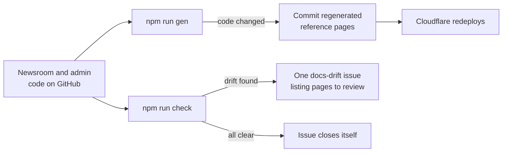

# This docs site

VitePress, deployed to Cloudflare Workers as static files. Repository: `krischan-acn/acn-docs`.

## What lives here and what doesn't

| Here (acn-docs) | In each code repo | In the knowledge base |
| --- | --- | --- |
| How the systems fit together, hosting, the API | `AGENTS.md` / `CLAUDE.md`: rules for agents | Who ACN is, people, brand |
| Staff guides, runbooks, glossary | `README.md`: one screen, links here | Status, roadmap, decisions about the client |
| Generated reference (routes, env vars, API calls) | `BIBLE.md` and `*.toon` (newsroom) | Logs of what happened |
| Decisions about the software | Deep dives tied to the code (`docs/`) | Accounts and where logins are kept |

The code repos stay lean: only what an agent editing that code must read before touching it.

## Writing

```bash
npm run dev     # live preview at http://localhost:5173
npm run build   # what Cloudflare runs; fails on dead links
```

- Pages are Markdown in `docs/`. Add new pages to the sidebar in `docs/.vitepress/config.mts`.
- **Every page starts with `reviewed: YYYY-MM-DD`** in frontmatter (see [keeping it true](#keeping-it-true)).
- **Diagrams:** fenced ` ```mermaid ` blocks. Stick to `flowchart`, `sequenceDiagram`, `stateDiagram-v2`, `erDiagram` and `gantt` so they render on GitHub too. Avoid the newer `-beta` diagram types and click handlers.
- **Big buttons:** `<div class="acn-buttons"><a class="acn-button" href="…">` with `acn-button-no`, `acn-button-title` and `acn-button-text` spans inside. For one main action, use `<a class="acn-cta">`.
- **Style:** short sentences, plain words, staff vocabulary from the [glossary](/start/glossary). Date facts that go stale ("as of 2026-10-23").
- **Never:** passwords, tokens, keys, or anything describing how to get past our security. The site is public.

## Generated reference

```bash
npm run gen
```

`scripts/generate.mjs` reads the newsroom and admin **from git**, not from the files on disk, at:

| Repo | Folder (env) | Default | Branch (env) | Default |
| --- | --- | --- | --- | --- |
| Newsroom | `NEWSROOM_DIR` | `../newsroom-main` | `NEWSROOM_REF` | `origin/main` |
| Admin | `ADMIN_DIR` | `../acn-admin` | `ADMIN_REF` | `origin/feat/api-write-wiring` |

It writes `docs/reference/generated/`: routes, env vars, API endpoints, newsroom components by tier, and the sector and industry list. Each page states the commit it came from. Run it after any change to routes, env vars or API calls, then commit the result here.

Both scripts read what's **on GitHub** (`origin/…`), so they never cite a commit that hasn't been pushed. Run `git fetch` in the code repos first when working locally. When the admin's write work merges to `master`, change the `ADMIN_REF` default in both `scripts/generate.mjs` and `scripts/check-drift.mjs`.

## Keeping it true

Nobody has to remember. The GitHub Action in `.github/workflows/sync.yml` runs every night at 02:00 (Manila/Singapore), on every push here, and from **Actions → Sync docs with code → Run workflow**.



**Every hand-written page carries a `reviewed:` date** in its frontmatter, shown at the top of the page. `npm run check` (`scripts/check-drift.mjs`) reads every file, folder and setting a page mentions in `backticks` and reports:

- **References that no longer exist**: a page mentions a file or setting the code no longer has.
- **Pages whose code changed since they were reviewed**: with the exact commits, so you know what to re-read.
- **Pages with no `reviewed:` date.**

When you've re-read a page against the code (and fixed it if needed), set its `reviewed:` date to today. When the last flagged page is done, the issue closes on the next run.

If a page has to mention something the code doesn't have (e.g. warning that a setting is ignored), add it to `KNOWN_ABSENT` in the script, with the reason.

::: tip New page
Start it with:
```md
---
reviewed: 2026-10-23
---
```
:::

## For AI tools

The build also writes:

- `/llms.txt`: an index of every page, with house rules on vocabulary and tone (set in `config.mts`, `llmsDetails`).
- `/llms-full.txt`: the whole site as one text file.
- a `.md` copy of every page next to its HTML.

Keep `llmsDetails` in step with the [glossary](/start/glossary).

## Deploying

Push to `main`. Cloudflare's Git integration runs `npm run build` and `npx wrangler deploy`. Setup steps are in [hosting](/build/hosting#this-site-on-cloudflare-workers). `public/_headers` adds `X-Robots-Tag: noindex`, so search engines skip the site; Claude and other tools can still read it.
