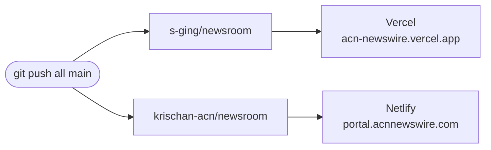

# Hosting and deploys

Every site deploys itself when code is pushed to GitHub. There are no deploy scripts to run and no servers to log into.

## Who serves what

| Site | Address | Host | Built from | Branch |
| --- | --- | --- | --- | --- |
| Newsroom | portal.acnnewswire.com | Netlify | `krischan-acn/newsroom` | `main` |
| Newsroom (second copy) | acn-newswire.vercel.app | Vercel | `s-ging/newsroom` | `main` |
| Admin | internal (address in the knowledge base) | Vercel | `s-ging/acn-admin` | `master` (to confirm) |
| Docs (this site) | to be set | Cloudflare Workers | `krischan-acn/acn-docs` | `main` |
| ACN API | development.acnnewswire.com | Azure VM, behind Cloudflare | separate .NET repo, API team | n/a |

DNS for `acnnewswire.com` is on Cloudflare; the domain is registered at GoDaddy. `portal` is a DNS-only CNAME to `acnnewswire.netlify.app`. The Azure VM is kept for SQL Server and the API only, to save bandwidth. Moving the sites onto it is parked.

## Why the newsroom is hosted twice



**On purpose, for redundancy.** If one host has an outage or a bad build, the other copy is still serving. Don't merge them into one.

The `all` remote pushes to both GitHub copies in one command (setup in [set up](/build/#newsroom)). Pushing to only one leaves the two sites on different versions. That is sometimes useful: push one, check it, then the other.

## Branches

- **`staging`** is where work lands first.
- **`main`** is what both hosts deploy. Promote with a fast-forward:
  ```bash
  git checkout main && git merge --ff-only staging && git push all main
  ```
- **`cloudflare`** (newsroom) is a shelved experiment: the newsroom on Cloudflare Workers through OpenNext. It needed an R2 bucket and Durable Objects just to keep caching working, which defeated the point of "connect and forget". Kept for reference, not deployed. See [decisions](/reference/decisions).

## Where settings live

None of the hosts' build settings or environment variables are in the code. They live in each dashboard:

- **Netlify:** site settings → Build & deploy; Environment variables.
- **Vercel:** project → Settings → Environment Variables.
- **Cloudflare:** Workers & Pages → `acn-docs` → Settings.

What each app reads is listed in [newsroom env vars](/reference/generated/newsroom-env) and [admin env vars](/reference/generated/admin-env). The admin's `vercel.json` is in its repo and holds the `/wire` proxy rule. The newsroom has no `netlify.toml` or `vercel.json`.

When you change a variable, **redeploy**. Variables are read at build time, so a change does nothing until the next build.

## This site on Cloudflare Workers

There is no Worker code. `wrangler.jsonc` only says "serve this folder":

```jsonc
{ "name": "acn-docs", "assets": { "directory": "./docs/.vitepress/dist" } }
```

Connecting it, once:

1. Cloudflare dashboard → **Workers & Pages** → **Create** → **Import a repository** → `krischan-acn/acn-docs`.
2. Build command `npm run build`. Deploy command `npx wrangler deploy`.
3. Optional custom domain: in the Worker's **Settings → Domains & Routes**, add e.g. `docs.acnnewswire.com`. DNS is already on Cloudflare, so it's one click.

After that, every push to `main` deploys. `wrangler dev` previews locally the way Cloudflare will serve it; for writing docs, `npm run dev` is all you need.

## Undoing a deploy

See [undo a bad deploy](/runbooks/rollback).
