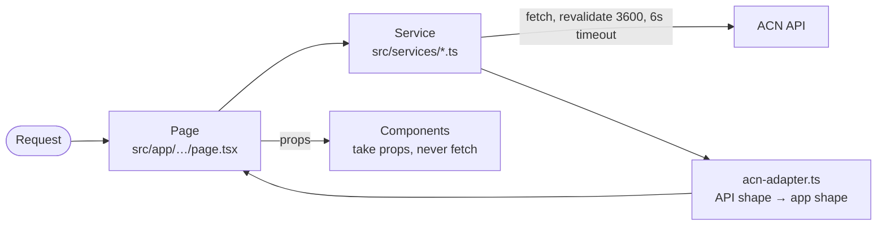

# Newsroom

Next.js 16 (App Router, React Server Components), React 19, Tailwind CSS 4, TypeScript. The public press release site.

::: tip The rules live in the repo
The newsroom's `BIBLE.md` is the binding contract for code changes: component tiers, hard rules, styling, what to run before you're done. This page explains the system around it. When they disagree on a code rule, `BIBLE.md` wins.
:::

## How a page gets its data

- **Pages and route handlers fetch. Components take props.** Three documented exceptions fetch from the browser: `AbOverlay`, `PressReleaseItem` (logo backfill) and `InfiniteArticleFeed`.
- Every API call goes through a service in `src/services/`, with a 6-second timeout (`src/lib/api-timeout.ts`).
- The API host is **hard-coded** in the services. `NEXT_PUBLIC_API_BASE_URL` is read by nothing.

Every route: [newsroom routes](/reference/generated/newsroom-routes). Every API call: [newsroom API calls](/reference/generated/newsroom-endpoints).

## Caching

- Caching is set **per `fetch()` call** (`next: { revalidate: 3600 }`), never as a route-segment export. There are zero segment exports in `src/app`; keep it that way.
- The homepage and article pages are ISR: built on the first visit, served from cache, rebuilt in the background at most once an hour.
- Next only caches **200** responses. Errors and timeouts are retried on every render.
- **Blank homepage risk.** Every homepage band turns API errors into an empty list, so it never crashes. If the API is down when the homepage rebuilds, the empty version is cached for up to an hour. See [homepage is blank](/runbooks/blank-homepage).
- **Article pages keep the last good copy.** Only a real API 404 gives "not found"; other errors are rethrown, so ISR keeps serving the previous version.
- **"Works locally, 404s deployed".** Your local `.next/cache/fetch-cache` holds old successful responses that a fresh deploy doesn't have. Always check on the deployed site.

## Press release URLs

`/article/<language>/<id>/<headline-slug>`, built by `articlePath()` in `src/services/acn-adapter.ts`.

- **The route resolves by ID only.** The language and slug are cosmetic; `/article/<id>` works.
- There is no redirect to the canonical URL; a canonical redirect on an ISR route bakes a 200 with a meta refresh. Instead the page sets `<link rel=canonical>`.
- Slug: Japanese kana → Hepburn; CJK and Latin separated; `transliteration` keeps a–z and 0–9 (kanji and hanzi get pinyin); cut at a word boundary under 80 characters; too short gives `press-release-<id>`. `transliteration` is **server-only**; the browser gets the finished path from `/api/press-release/<id>`.
- Known: Japanese kanji still get Mandarin readings. Language is often unknown (the old enrichment API is down), so most URLs say `english`.

## Taxonomy and languages

- **Sector and industry** logic goes through `src/lib/taxonomy.ts`. Never use the older `sector-mapper.ts` for new code. The data's field names are one level off: `sector_type` is the sector and `sector_name` the industry. Full list: [sectors and industries](/reference/generated/taxonomy).
- **Language** strings resolve through `src/lib/languages.ts`. It accepts most spellings (`zh-TW`, `cht`, `big5`…). Never hand-roll one.

## Design voting (A/B)

An employee-only overlay mounted in `app/layout.tsx`. The code is in `src/ab/` and `src/components/common/ab/`.

- **Login:** F2 or the hidden dot in the top bar. Users and admins come from `AB_USERS` and `AB_ADMINS`. Sessions are cookies signed with `AB_SECRET`; if `AB_SECRET` is empty, no session is ever accepted, so login appears to work but doesn't stick.
- **Votes:** stored in Upstash Redis (`UPSTASH_REDIS_REST_URL` / `_TOKEN`). Without those, a local JSON file is used, which doesn't survive serverless deploys.
- **To add an experiment:**
  1. Add an entry to `EXPERIMENTS` in `src/ab/experiments.ts`.
  2. Write `public/ab-variants/<id>.css`, scoped to `[data-ab-target="<id>"]`.
  3. Add `data-ab-target="<id>"` to the markup.
  4. Switch it on at `/admin`.
- No experiments are defined yet.

## Styling

Flat, square, quiet: weightless Inter headings in pure black, hairline rules, one accent (`#2088c9`), `.button` / `.button.alt` for anything button-shaped, no rounding or shadows on public pages. `STYLING.toon` in the repo has the canonical class strings and known divergences.

## Known open items

- **Infinite scroll** works out "next article" from the latest 20 releases, in the browser, against an API that sends no CORS headers. It most likely never loads a second article in production. A server-side "next articles" endpoint has been specified for the API team.
- **Canonical host.** `NEXT_PUBLIC_SITE_URL` defaults to `www.acnnewswire.com`, where article paths 404. Set it to the newsroom's real host.
- **OG images** may double the logo URL prefix (`src/app/api/og/article/[id]/route.tsx`).
- **Event images** under `www.acnnewswire.com/eventimages` aren't in `images.remotePatterns`, so they use plain ``.
- `npm run lint` is broken (the `ajv` override vs eslint 10). There is no test runner.
- `next-intl` is installed but never used. `README.md` in the repo predates most of this and is unreliable.

## Generated files in the repo

- `COMPONENTS.toon`: every component, its tier and its importers. Regenerated by `npm run components:map` and by the pre-commit hook.
- `PROJECT-CONTEXT.toon`: hand-written map of routes, services and API health. Check its `updated` date before trusting it.
