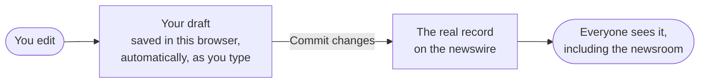

# How saving works in the admin

The admin has two kinds of saving. Knowing the difference stops almost every "where did my change go?" moment.

::: info If your admin has a "Save" button instead of "Commit changes"
You're on an older version, where every save stays in your browser. This page describes the newer version, which is being rolled out.
:::

## Your draft, and the real record

- **As you type**, every change saves itself as a **draft** in your browser. You can close the tab and come back; it's still there. The top bar says "*N uncommitted changes · saved locally*".
- **When you press "Commit changes"** (or Ctrl+S / Cmd+S), the admin sends the draft to the newswire, then reads the record back to make sure it arrived.

Drafts live in **this browser on this computer only**. Another computer, another browser, a private window, or clearing your browsing data all mean you won't see them.

## The commit window

Commit opens a list of every change, grouped by tab. Before you confirm:

- A row marked **local only** cannot be sent yet. The newswire has no place for that field so far: contacts, distribution settings, Reuters and Bloomberg codes, sector, portal login, and uploaded files. Hover to see why. These stay in your draft.
- If someone else changed the same company since you started, you'll see **"Changed on the newswire since you started editing"**, with both versions side by side. Choose **Keep newswire version** or **Overwrite with mine**.
- **Cancel** and **Discard** must be held down for a moment, so you can't trigger them by accident.

## The messages you might see

| Message | What happened | What to do | Is anything lost? |
| --- | --- | --- | --- |
| Saved to the newswire. | Everything went through and was checked. | Nothing. | No. |
| Saved… N changes with no API endpoint stay local. | Most went through; some fields have nowhere to go yet. | Nothing. They wait in your draft. | No. |
| N changes did not show up in the API after saving… kept as a draft. | The newswire accepted the request but the change isn't there when we check. | Try again later. If it keeps happening, tell a developer. | No, still in your draft. |
| Nothing was sent: the API could not be reached. | The newswire is down or unreachable. | Wait and try again. See [the API is down](/runbooks/api-down). | No. |
| Nothing was sent: the API refused the request. | The newswire said no, usually a login or permissions problem. | Tell a developer. | No. |
| Browser storage is full — this edit is not saved locally. | Your browser has run out of room for drafts, usually because of big images. | Commit what you can, or discard drafts you don't need. | **Yes, that last edit**, unless you commit now. |
| Could not reach the newswire API — showing the last synced copy | You're looking at a saved copy from earlier. | Fine for reading. Don't rely on it being current. | No. |

## The status line on list pages

| It says | Meaning |
| --- | --- |
| Syncing… | Fetching fresh data now. |
| Synced · 2 min ago | Fresh from the newswire. |
| Cached · 40 min ago | A saved copy from earlier, shown because it's quicker. Press **Refresh** for the latest. |
| Offline · local records only | The newswire can't be reached and there's no saved copy. You only see your own drafts. |

Lists refresh themselves after an hour. **Refresh** always gets the latest.

## What saves for real, and what doesn't yet

| | Saves to the newswire | Stays in your browser |
| --- | --- | --- |
| **Companies** | Names, About text, details, address, links, Instagram, exchange listings, industry | Contacts, distribution, Reuters/Bloomberg codes, sector, status, languages, logos, annual reports |
| **Press releases** | Nothing yet | Everything. The newswire can't accept press releases from the admin yet. |
| **Events** | Everything on the event page | Nothing |

This changes as the newswire adds the missing pieces. The developer view is in [the admin build notes](/build/admin#what-can-be-saved).
