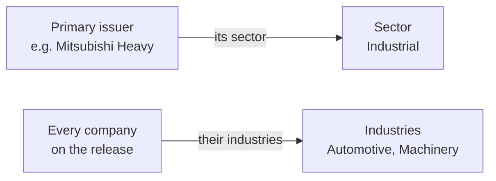

# Press releases

::: warning The press release editor saves to your browser only
The newswire can't accept press releases from the admin yet. Everything you do here stays on this computer. Use it to prepare and check releases, not to publish them.
:::

## The list

There are about 80,000 press releases, too many to load at once, so the list shows **50 at a time**.

- Search, filters and the date picker only cover **the page you're on**. To find an older release, page back or open it by number.
- The total at the bottom takes about half a minute to count the first time ("Counting press releases…"), then it's remembered for a day.

Columns: release (headline and number), status, primary issuer ("Mitsubishi Heavy +2" means two more companies are on it), sector and industry, language, published date.

## The editor

On the left is the release itself:
- Headline, subheadline, summary.
- The main content: rich text with images up to 1 MB each.
- An optional **custom About**, which replaces the company's usual boilerplate for this release only.

The **dateline** ("TOKYO, August 14, 2026") is built for you from the location and the date. If you type your own, it sticks. **Use location** switches back to the automatic one.

## The panel on the right

| Group | What's in it |
| --- | --- |
| **Publication** | Date and time · Status (Draft, Scheduled, Published, Archived) · **Companies** on the release, one marked as **primary issuer** |
| **Classification** | Sector and industry (filled in for you, see below) · topic · languages |
| **Location** | Region · location (also used for the dateline) |
| **Relations** | Supplier · contacts (from the companies on the release) · translations |
| **Distribution** | Release type · tracking number · distribute to · source |
| **Workflow** | Reported by · sent by (closed by default) |

## Sector and industry fill themselves in

You don't pick them. They come from the companies on the release:

- The **sector** is the primary issuer's sector.
- The **industries** are every company's industry, with no repeats.
- To set them by hand, press **Override**. **Use derived** puts the automatic ones back.

If you remove the primary issuer, the next company in the list becomes primary.

::: warning Only companies you've opened can be added
The "+ Add company" picker only lists companies already opened in the admin on this computer. Open the company once from the Companies list first.
:::

## Spreadsheet view

Read-only for now. It shows the first page of releases in a sheet.
