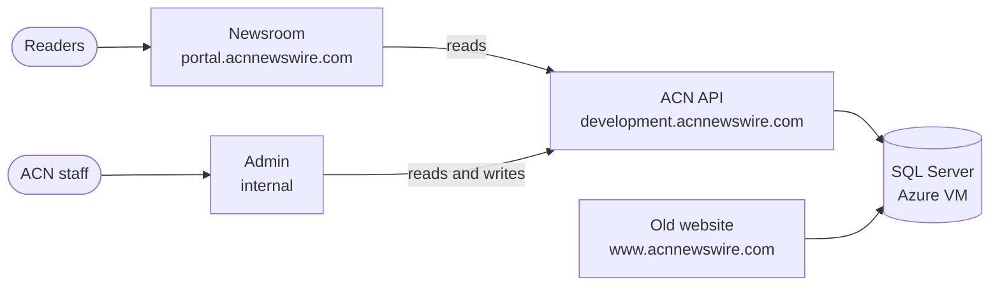

  
ACN Newswire · Documentation

  <h1>How our sites work, and how to work them.</h1>
  
Two pieces of software: the <strong>newsroom</strong>, the public website where readers find press releases, and the <strong>admin</strong>, the internal tool where we edit companies, press releases and events.

  <a class="acn-button" href="/guide/">
    01
    I work at ACN
    How to use the admin and what readers see on the newsroom. No jargon.
  </a>
  <a class="acn-button" href="/runbooks/">
    02
    Something is broken
    The site is blank, a release won't open, the admin won't save. What to do, step by step.
  </a>
  <a class="acn-button" href="/build/">
    03
    I build or fix things
    Setting up the code, where everything is hosted, the rules each codebase follows.
  </a>
  <a class="acn-button" href="/start/ask-claude">
    04
    Ask Claude
    Have Claude read all of this and answer your question in plain words.
  </a>

## The whole thing on one page

Start with [the map](/start/map) for the full picture, or the [glossary](/start/glossary) if a word on this site means nothing to you.

