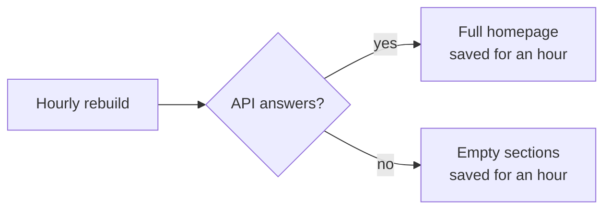

# Homepage is blank

## What you'll see

The newsroom homepage loads but the photo carousel, event row, featured releases or sector rows are empty or missing.

::: tip Two rows are always empty
**Cryptocurrency** and **Sustainability** have no releases in the new data yet. Those two being empty is normal.
:::

## Why it happens

The homepage is saved and reused for up to an hour. Each section is built to show "nothing" rather than crash when the newswire doesn't answer. So if the newswire was down at the moment the page was rebuilt, the empty version gets saved and shown until the next rebuild.

The featured band disappears completely if its lead release (85791) can't be loaded.

## What to do

1. **Check the API is up**; see [the API is down](/runbooks/api-down). If it isn't, fix that first.
2. Once the API is up, **wait for the next rebuild**. The page fixes itself within the hour once someone visits it.
3. **Faster:** trigger a fresh deploy of the affected host, so the page is rebuilt against the working API:
   - **Netlify** (portal.acnnewswire.com): Deploys → **Trigger deploy** → *Clear cache and deploy site*.
   - **Vercel** (acn-newswire.vercel.app): Deployments → latest → **⋯** → *Redeploy*.

::: warning Don't redeploy while the API is down
A build during an outage bakes the empty homepage in. Fix the API first.
:::

## The lasting fix (not done yet)

Don't cache a homepage whose sections all came back empty, so the last good version keeps showing. Tracked in the knowledge base status list.
