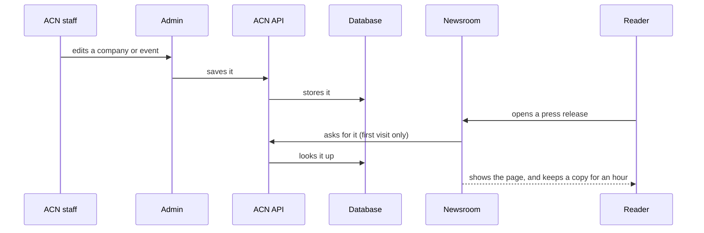
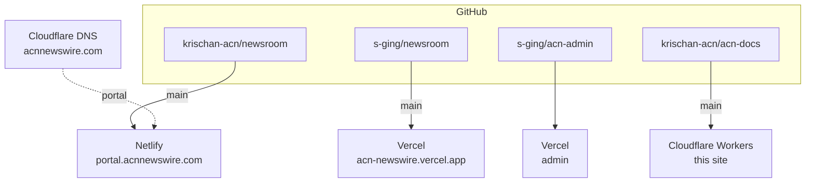

# The map

Everything ACN runs, what talks to what, and where each piece lives. If you read one page on this site, read this one.

## The pieces

| Piece | What it is | Who uses it | Where it lives |
| --- | --- | --- | --- |
| **Newsroom** | The new public website. Press releases, company pages, events, search. | Readers, journalists, investors | portal.acnnewswire.com (Netlify) and acn-newswire.vercel.app (Vercel) |
| **Admin** | The internal editing tool. Companies, press releases, events. | ACN staff | Vercel (address kept off this public site) |
| **ACN API** | The service both apps get their data from. | The two apps, not people | development.acnnewswire.com, on an Azure VM |
| **Database** | SQL Server holding every company, press release and event. | The API and the old site | The same Azure VM |
| **Old website** | The original site, classic ASP on IIS. Still live. Not covered by these docs yet. | Readers | www.acnnewswire.com |
| **Knowledge base** | Top-level notes about ACN as a client: people, decisions, status. | The team | GitHub `krischan-acn/ACN-knowledge-base` (private) |

::: tip "development" is production
The API's address says *development*, but it is the one the live newsroom uses. Don't read the name as "safe to experiment on".
:::

## How a press release reaches a reader

The newsroom keeps a copy of each page for up to an hour, so it stays fast and keeps working for a while if the API goes down. The downside is that a change can take up to an hour to show. See [the API is down](/runbooks/api-down).

::: info Press releases are not written in the admin yet
The admin's press release editor saves to your browser only. The API has no way to accept a press release yet. Companies and events do save for real.
:::

## Where the code and the hosting live

The newsroom is deliberately hosted twice, from two GitHub copies of the same code. If one host has an outage or a bad deploy, the other is still up. Every push goes to both copies at once. Details in [hosting and deploys](/build/hosting).

## Where to go next

- Never used the admin? [The staff guide](/guide/).
- Something on this page means nothing to you? [The glossary](/start/glossary).
- Going to change code? [Set up](/build/), then [how we work](/start/principles).
